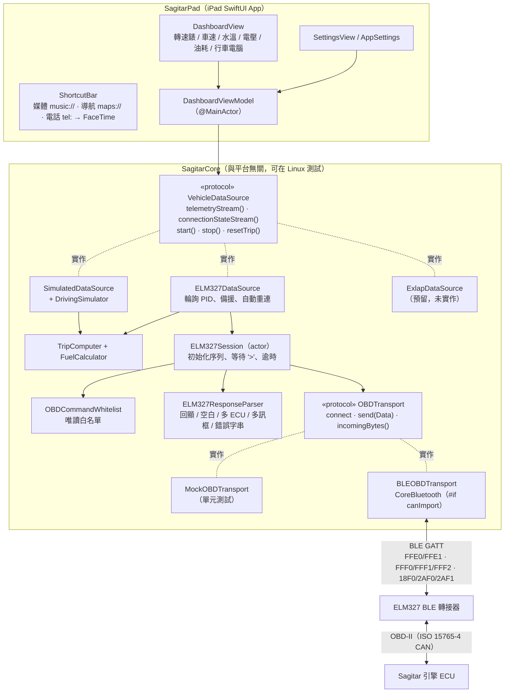

# SagitarPad — 2018 Sagitar 的 iPad 車機儀表板（原型）

把 2018 年 Volkswagen Sagitar（PQ 平台，MIB2 Standard 主機）車機上常用的功能，搬到一台橫放的 iPad 上：
車速、轉速、水溫、電壓、油耗、行車電腦，加上「媒體／導航／電話」三個大按鈕。

> ⚠️ **安全第一**
> - **行車中請勿操作 iPad。** 請由乘客操作，或停車後再操作。iPad 要用穩固的支架固定，不可擋住視線或安全氣囊。
> - 這個 App **只讀不寫**：不會清除故障碼、不會改編碼、不會在 CAN 匯流排上送任何自訂訊框（程式碼裡有白名單強制執行，見下方「安全設計」）。
> - 這個 App **不會取代或修改原車主機**，原車主機照常運作。

---

## 1. 資料夾結構

```
sagitar-ipad/
├── README.md                 ← 本文件
├── project.yml               ← XcodeGen 設定（iPad App target，iPadOS 16+，只有橫向）
├── SagitarPad.xcodeproj/     ← 已用 XcodeGen 產生好的 Xcode 專案（在 Mac 上直接開）
├── SagitarCore/              ← 與平台無關的核心程式庫（Swift Package，Linux / Mac 都能 swift test）
│   ├── Package.swift
│   ├── Sources/SagitarCore/
│   │   ├── Models/           TelemetrySnapshot、TripSummary、ConnectionState、DataSourceKind
│   │   ├── OBD/              OBDPID（公式）、OBDCommandWhitelist（唯讀白名單）、
│   │   │                     ELM327ResponseParser（回應解析）、ELM327Session（協定流程）、ELM327Error
│   │   ├── Transport/        OBDTransport 協定、MockOBDTransport、BLEOBDTransport（CoreBluetooth）
│   │   ├── DataSources/      VehicleDataSource 協定、SimulatedDataSource + DrivingSimulator、
│   │   │                     ELM327DataSource（+ ELM327BLEDataSource）、ExlapDataSource（預留）
│   │   ├── Trip/             FuelCalculator（油耗推估）、TripComputer（行車電腦）
│   │   └── Support/          AsyncBroadcaster、鎖工具
│   └── Tests/SagitarCoreTests/   73 個 XCTest 單元測試
├── SagitarPad/               ← iPad SwiftUI App
│   ├── Info.plist            （藍牙權限說明、只支援橫向、深色）
│   ├── Sources/App/          SagitarPadApp（進入點）
│   ├── Sources/ViewModels/   DashboardViewModel
│   ├── Sources/Services/     AppSettings（設定）、ShortcutLauncher（開 Music / 地圖 / 電話）
│   ├── Sources/Views/        DashboardView、RPMGaugeView、MetricCard、TripComputerCard、
│   │                         ConnectionStatusBar、ShortcutBar（含撥號面板）、SettingsView、Theme
│   └── Resources/            zh-Hant.lproj / en.lproj（Localizable.strings、InfoPlist.strings）、Assets
└── tools/
    ├── gen_strings.py        產生中英文字串檔，並檢查程式用到的字串都有翻譯
    ├── typecheck-ble.sh      在 Linux 上用假的 CoreBluetooth 模組檢查 BLE 程式碼的型別
    └── typecheck-stubs/
```

## 2. 架構

核心原則：**UI 只認得 `VehicleDataSource` 這個介面**；**傳輸層（位元組進出）和 ELM327 協定邏輯分開**，
所以協定可以在沒有 iPad、沒有車的情況下，用假的傳輸層（`MockOBDTransport`）完整測試。



### 資料流程（BLE OBD）

1. `BLEOBDTransport` 掃描常見的 ELM327 BLE 服務（`FFE0/FFE1`、`FFF0/FFF1/FFF2`、`18F0/2AF0/2AF1`、Vgate 自訂 UUID），
   找到通知（notify）與寫入（write）特徵值並開啟通知。有些轉接器不廣播服務 UUID，所以預設也會用名稱（OBD、ELM、Vgate、V-LINK…）辨識。
2. `ELM327Session` 送出初始化序列 `ATZ → ATE0 → ATL0 → ATS0 → ATH0 → ATSP0`，再送 `0100` 觸發自動搜尋協定並讀「支援的 PID」遮罩（必要時再問 `0120`、`0140`），最後 `ATDP` 讀協定名稱。
3. 每條指令都要等到 `>` 提示字元才算完成（BLE 一次通知只有約 20 位元組，回應會被切成很多段，Session 會先暫存）。
4. 輪詢：每輪讀 `010C` 轉速、`010D` 車速、`0110` 進氣量；每 10 輪讀一次 `0105` 水溫、`012F` 油量、`0142` 電壓。
5. 由進氣量和車速算瞬時油耗，`TripComputer` 依時間積分出里程、時間、耗油量、平均車速、平均油耗。

### 公式（SAE J1979 標準 PID）

| PID | 意義 | 公式 |
|---|---|---|
| 010C | 引擎轉速 | (256A + B) / 4 rpm |
| 010D | 車速 | A km/h |
| 0105 | 冷卻液溫度 | A − 40 °C |
| 0142 | 控制模組電壓 | (256A + B) / 1000 V（不支援時改用轉接器的 `ATRV`） |
| 012F | 油箱油量 | 100A / 255 % |
| 0110 | 進氣流量 MAF | (256A + B) / 100 g/s |
| 010B / 010F | 進氣壓力 MAP / 進氣溫度 | A kPa / A − 40 °C（MAF 不支援時用來推估進氣量） |
| 0100 / 0120 / 0140 | 支援的 PID | 32 位元遮罩 |

**油耗推估**：L/h = MAF(g/s) × 3600 ÷（空燃比 14.7 × 汽油密度 745 g/L）× 校正係數；
L/100km = L/h ÷ 車速 × 100（車速 < 5 km/h 時改顯示 L/h）。
這是推估值，和原廠儀表可能差 10–15%，可在「設定 → 油耗推估 → 校正係數」調整（加滿油後用「實際加油量 ÷ App 顯示的耗油量」）。
許多 VW TSI 引擎用 MAP 感知器、不一定支援 `0110`，此時會自動改用「速度—密度法」（MAP + 進氣溫度 + 排氣量）估算。

## 3. 已實作功能

- **橫向車機風格儀表板**（深色、按鈕至少 48–96 pt 高）：
  - 轉速錶（270° 圓弧、6000 rpm 以上紅區），中央大字車速
  - 水溫（未暖車藍色、過熱紅色）、電壓（區分充電中 / 電瓶）、瞬時油耗（L/100km 或怠速時 L/h，附本次平均）
  - 行車電腦：里程、行駛時間、平均車速、平均油耗、耗油量、油量（含剩餘公升數），可歸零
- **捷徑**：媒體（`music://` 開 Apple Music）、導航（`maps://` 開 Apple 地圖）、電話（撥號面板：先試 `tel:`，iPad 不能打電話時改 `facetime-audio:` / `facetime:`；可設定常用號碼）
- **連線狀態列**：狀態燈、狀態說明、時鐘、資料來源選單（模擬器 / BLE OBD / Exlap）、重新連線、設定
- **設定**：資料來源、BLE 掃描方式、輪詢間隔、油耗校正、排氣量、油箱容量、常用電話、保持螢幕常亮、安全說明
- **介面語言**：繁體中文（預設）＋英文
- **資料來源**：
  - `SimulatedDataSource`：擬真行駛（怠速→加速→巡航→減速、7 速 DSG 換檔、暖車、充電電壓、油量下降），沒車也能展示
  - `ELM327DataSource` + `BLEOBDTransport`：真實 BLE ELM327；處理 `SEARCHING...`、`NO DATA`、`UNABLE TO CONNECT`、`?`、`STOPPED`、`BUS INIT`、`CAN ERROR`、`BUFFER FULL` 等；車輛未發動時會顯示「車輛沒有回應」並自動重試；斷線自動重連；不支援的 PID 自動跳過
  - `ExlapDataSource`：預留位置，程式註解說明了實作需要什麼

## 4. 安全設計（唯讀）

`OBDCommandWhitelist` 採**白名單**：只有下列指令能送出，其他一律在 `ELM327Session.send` 裡被擋下（丟出 `commandNotAllowed`，根本不會碰到藍牙）：

- AT 指令（只改轉接器自己的設定）：`ATZ ATWS ATE0 ATL0 ATS0 ATH0 ATSP0 ATI ATRV ATDP ATDPN ATAT1 ATPC`
- Mode 01 讀取：`0100 0105 010B 010C 010D 010F 0110 0120 012F 0140 0142`

因此 Mode 04（清除故障碼）、Mode 08、UDS 寫入（`2E`、`31`、`14`…）、`AT SH`（設定標頭後送自訂 CAN 訊框）、`AT MA`（監聽）、`ATPP`（改轉接器 EEPROM）、STN 的 `STPX`、夾帶換行的多重指令等全部會被拒絕，單元測試有逐一驗證。

## 5. 需要的硬體

| 項目 | 說明 |
|---|---|
| iPad | iPadOS 16 以上（App 只支援橫向） |
| **BLE（藍牙 4.0 / Bluetooth Low Energy）ELM327 OBD-II 轉接器** | 例如 Vgate iCar Pro BLE、Veepeak OBDCheck BLE、OBDLink CX、Konnwei KW902 BLE 等標示「支援 iOS / iPhone」的款式。插在方向盤下方（駕駛座左下）的 OBD-II 接頭。 |
| ❌ **不能用：傳統藍牙（Classic Bluetooth / SPP）轉接器** | 很多便宜的「Bluetooth ELM327」（配對碼 1234 / 0000 那種）是 SPP 傳統藍牙，**iOS 不允許一般 App 使用 SPP**（需要 Apple MFi 認證），所以 iPad 完全連不上。購買前請確認寫明「BLE」或「Bluetooth 4.0」並支援 iOS。 |
| （未來選項）Wi-Fi ELM327 | Wi-Fi 款通常是 TCP `192.168.0.10:35000`，iOS 可以用；但 iPad 連上轉接器的 Wi-Fi 後就沒有網路（地圖、音樂串流會受影響）。程式已把傳輸層抽象化，未來加一個 `WiFiOBDTransport`（Network.framework `NWConnection`）即可，協定與解析不用改。**目前未實作。** |

> 小提醒：轉接器長時間插著可能會慢慢耗電瓶，長時間停車建議拔掉。

## 6. 在 Mac 上開啟並安裝到 iPad（免費 Apple ID）

這部分需要一台 Mac（這個專案是在 Linux 上寫的，**iOS App 還沒有被真正編譯過**，第一次在 Xcode 編譯時可能需要小修正）。

1. **安裝 Xcode**：在 Mac 的 App Store 搜尋「Xcode」安裝（免費，檔案很大）。安裝後開一次，同意授權並等它安裝元件。
2. **取得專案**：把整個 `sagitar-ipad` 資料夾複製到 Mac。
3. **開啟專案**：雙擊 `SagitarPad.xcodeproj`。
   - 如果專案打不開或你改了 `project.yml`：在「終端機」執行
     `brew install xcodegen`（需先安裝 [Homebrew](https://brew.sh)），然後在 `sagitar-ipad` 資料夾執行 `xcodegen generate`，會重新產生 `SagitarPad.xcodeproj`。
4. **登入 Apple ID**：Xcode → Settings（設定）→ Accounts → 左下「+」→ Apple ID，登入你的 Apple ID（免費帳號即可）。
5. **設定簽署**：左側點最上面的「SagitarPad」專案 → TARGETS 選「SagitarPad」→「Signing & Capabilities」：
   - 勾選「Automatically manage signing」
   - Team 選「你的名字 (Personal Team)」
   - 如果出現 bundle identifier 已被使用的錯誤，把 `com.kwok.sagitarpad` 改成獨一無二的，例如 `com.kwok.sagitarpad.你的名字縮寫`。
6. **連接 iPad**：用 USB 線接上 Mac，iPad 上出現「要信任這部電腦嗎？」→ 信任，輸入密碼。
7. **開啟 iPad 的「開發者模式」**（iPadOS 16 以上必要）：iPad「設定」→「隱私權與安全性」→ 最下面「開發者模式」→ 打開 → 重新開機 → 開機後再確認開啟。
   （如果找不到這個選項，先做第 8 步讓 Xcode 試著安裝一次，選項就會出現。）
8. **安裝**：Xcode 上方的裝置選單選你的 iPad，按 ▶︎（Run）。第一次會比較久。
9. **信任開發者**：如果 iPad 顯示「不受信任的開發者」：iPad「設定」→「一般」→「VPN 與裝置管理」→ 點你的 Apple ID → 信任。
10. 打開 App，第一次選 BLE OBD 時會詢問藍牙權限，請選「允許」。

**免費 Apple ID 的限制**：

- 用免費帳號簽署的 App **7 天後會失效**（打開會閃退）。到時候把 iPad 接回 Mac，在 Xcode 再按一次 ▶︎ 重新安裝即可（資料與設定通常會保留）。
- 免費帳號同時最多只能在裝置上安裝 3 個自己簽署的 App。
- 若想要一年才過期，需付費加入 Apple Developer Program（每年 USD 99）。

## 7. 使用方式

1. 先用「模擬器」資料來源確認畫面正常（預設就是模擬器）。
2. 把 BLE ELM327 轉接器插到車上的 OBD-II 接頭，**發動引擎**（或至少把鑰匙轉到 ON）。
3. 在 App 右上角的資料來源選單選「BLE OBD」。狀態列會依序顯示：搜尋轉接器 → 連線中 → 初始化 → 已連線。
4. 不需要在 iPad 的「設定 → 藍牙」裡配對 BLE 轉接器，App 會自己連。（若轉接器已被其他 App 連住，請先關掉那個 App。）
5. 狀態是「車輛沒有回應」：表示轉接器有連上但車上 ECU 沒回應，請確認已發動 / 開 ACC，App 會每 3 秒自動重試。

## 8. 測試

核心程式庫可在 Mac 或 Linux 上執行：

```bash
cd SagitarCore
swift test
```

測試涵蓋（共 73 個）：

- 回應解析：有空白／無空白、小寫、LF 換行、回顯（獨立一行與黏在同一行）、`SEARCHING...`、`BUS INIT: ...OK`、
  所有錯誤字串、`<DATA ERROR`、多個 ECU（無標頭取第一個、有標頭優先 7E8）、多個 ECU 的支援遮罩取聯集、
  ISO-TP 多訊框（含長度行、無空白、與單訊框混合）、NUL 字元、亂碼、PID 不符、位元組不足、`ATRV`
- 公式：每個 PID 的邊界值、支援遮罩解碼
- 油耗：L/h、L/100km、低速回傳 nil、校正係數、速度—密度法、行車電腦積分、斷線空檔不積分、歸零
- 白名單：允許清單、各種寫入 / 未列出 / 夾帶換行 / 全形字元的指令都被拒絕
- ELM327 Session（用模擬的 ELM327 + `MockOBDTransport`）：完整初始化序列、1/3/7/20 位元組分段、
  被擋的指令完全不會送到傳輸層、逾時、雜訊與遲到回應、UNABLE TO CONNECT、NO DATA、STOPPED 重試、
  轉接器忽略 ATS0/ATH0、斷線
- 資料來源：ELM327DataSource 產生完整快照且送出的指令全在白名單內、MAF / 0142 不支援時的備援、
  車輛沒回應→發動後自動連上、連線失敗狀態、模擬器可重現且數值合理（30 分鐘模擬）、Exlap 預留回報 unavailable

其他檢查工具：

```bash
python3 tools/gen_strings.py   # 重新產生中英文字串檔，並確認程式用到的每個字串都有翻譯
tools/typecheck-ble.sh         # Linux 上用假的 CoreBluetooth 模組檢查 BLE 程式碼型別（只能抓語法/型別錯誤）
```

## 9. 限制與注意事項

- **iOS 只能和 BLE 轉接器溝通**：傳統藍牙 SPP 轉接器在 iPad 上無法使用（見第 5 節）。
- **不寫 CAN**：App 只讀取標準 OBD-II 資料，不會、也沒辦法清除故障碼或改設定（這是刻意的設計）。
- **只有標準 OBD-II PID**：PQ 平台的 Sagitar 在 OBD 接頭上只保證有排放相關的標準 PID。
  VW 專屬資料（車門 / 後車廂狀態、外部溫度、原廠油耗與續航、胎壓、MIB 主機功能如收音機、車輛設定等）**拿不到**，
  需要 Exlap（透過 MIB2 主機，見 `ExlapDataSource.swift` 註解）或 VW 專用診斷協定（KWP2000/UDS 經過 gateway，會需要放寬白名單並仔細評估），都**尚未實作**。
- **數值會和原廠儀表略有差異**：車速是 ECU 回報值（原廠儀表通常刻意顯示偏高幾 %）；油耗是推估值。
- **更新頻率**：便宜的 BLE 轉接器每秒大約只能回 5–15 個 PID，所以轉速錶每秒約更新 3–5 次，不像原廠指針那麼順。
- **這不是車機替代品**：不會取代或修改原車 MIB2 主機，倒車影像、原車設定、方向盤按鍵等都還在原主機上。
- **行車中請勿操作**。
- 若 MIB2 主機有 App-Connect 授權，可能本來就支援 CarPlay，可以順便確認。

## 10. 尚未完成 / 未驗證

- iOS App（SwiftUI 介面、CoreBluetooth）**尚未在 Xcode 上編譯，也沒在真的 iPad 和車上測試過**（開發環境是 Linux，沒有 Apple SDK）。
  核心程式庫已在 Linux 上編譯並通過全部單元測試；BLE 程式碼只用假的 CoreBluetooth 模組做過型別檢查。
- 沒有實測過哪些 BLE 轉接器、哪些 PID 在這台 Sagitar 上可用（例如 `0142`、`0110` 是否支援）。
- Exlap 只是預留位置。Wi-Fi ELM327 未實作。
- 沒有記住上次連線的轉接器（目前每次自動連第一個找到的）；沒有多台轉接器的選擇畫面。
- App 在背景時不會繼續讀資料（iPad 鎖螢幕後會斷線，回到前景時請按「重新連線」）。
